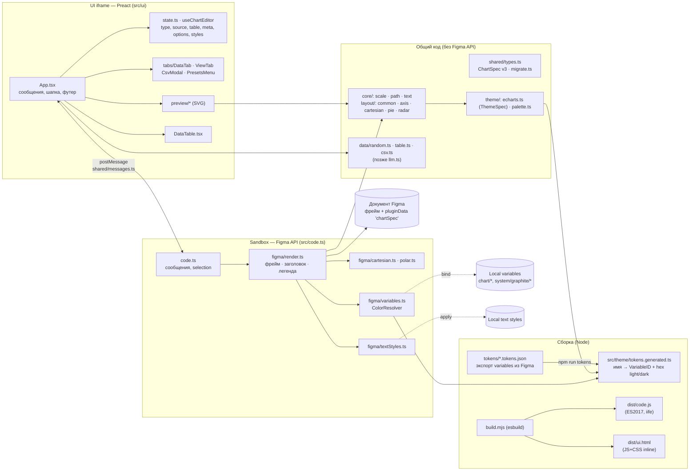
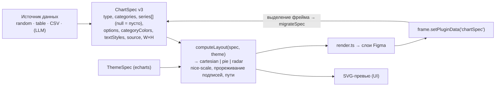
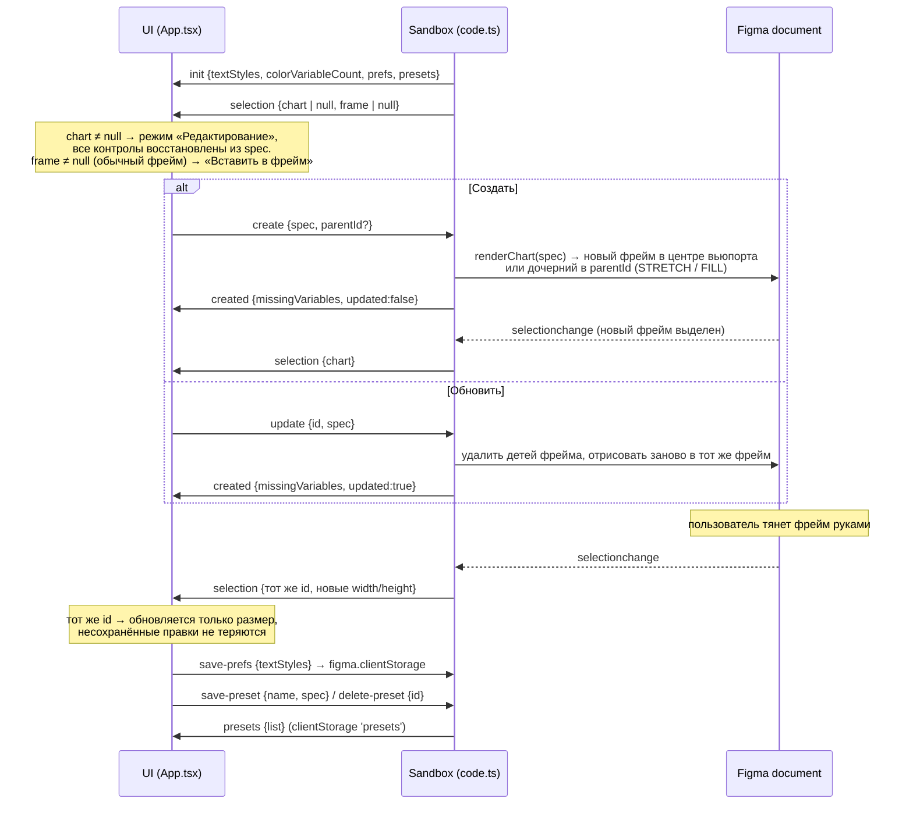
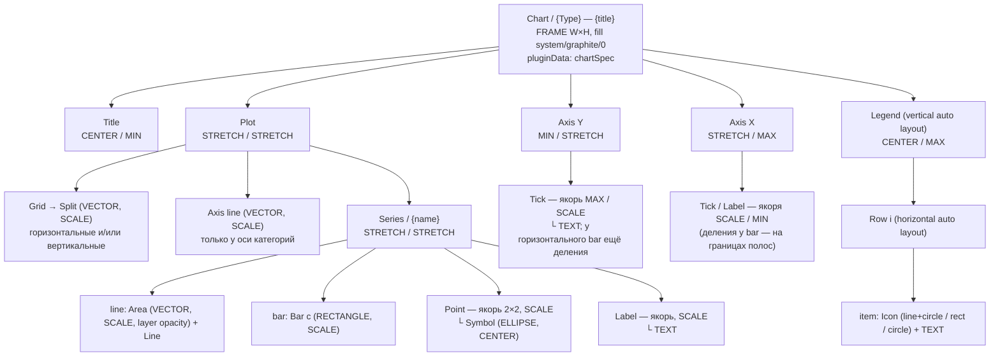
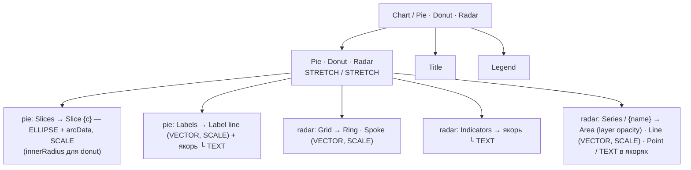

# Архитектура graph-plugin

Схемы в Mermaid — рендерятся в VS Code (Markdown Preview Mermaid), GitHub, Obsidian.

## 1. Общая картина

Ключевая идея: **ChartSpec** (что рисуем) и **ThemeSpec** (как выглядит) разделены, а геометрия считается в
одном месте — `core/layout.ts`. Её используют и SVG-превью, и рендер в Figma, поэтому они совпадают.

## 2. Поток данных

Прореживание: `categoryAxis` считает шаг категорий и показывает каждую k-ю подпись
(`k = ceil((макс. ширина подписи + minLabelGap) / шаг)`), `valueAxis` выбирает число делений по длине оси.
Точки и столбцы рисуются все. Подсказку «Подписей по оси: N из M» UI берёт из `layout.category`.

## 3. Сообщения UI ↔ sandbox

## 4. Дерево слоёв графика и constraints

Декартовы типы (line, bar — вертикальный / горизонтальный, scatter):

Полярные типы (pie / donut, radar) — тело растягивается как `Plot`, фигуры SCALE, тексты и точки в якорях
(при непропорциональном resize круг становится овалом, «Обновить» возвращает круг):

«Якорь» — прозрачный фрейм 2×2 с `SCALE`: при ручном resize его центр едет пропорционально данным,
а содержимое с `CENTER` не деформируется (круги остаются кругами, текст — текстом).

## 5. Где что лежит

| Файл | Ответственность |
|---|---|
| `src/code.ts` | точка входа sandbox: `showUI`, поиск графика в выделении (+ `migrateSpec`), `create` / `update` |
| `src/shared/types.ts` | ChartSpec v2, ChartType, ChartOptions (+ `DEFAULT_OPTIONS`) |
| `src/shared/migrate.ts` | спека из `pluginData` любой версии → текущая |
| `src/figma/render.ts` | `renderChart`: фрейм, заголовок, легенда, `pluginData`, пересборка в существующий фрейм |
| `src/figma/cartesian.ts` | line / bar / scatter → Plot, оси, серии |
| `src/figma/polar.ts` | pie (ELLIPSE + arcData) и radar |
| `src/figma/nodes.ts` | хелперы: container, anchor, pin, vector, stroke |
| `src/figma/variables.ts` | поиск переменной: VariableID → имя → имя без первой группы → hex-fallback |
| `src/figma/textStyles.ts` | список локальных text styles, создание текста со стилем или fallback-шрифтом |
| `src/core/scale.ts` | nice-scale как в ECharts, `formatNumber` (без `Intl`!) |
| `src/core/path.ts` | polyline / smooth (порт ECharts) / area / band / polygon / sector, `normalizePath`, `shiftPath` |
| `src/core/text.ts` | оценка ширины текста без DOM |
| `src/core/layout/*` | вся геометрия (общая для превью и Figma): `common` (фрейм, легенда с переносом, коллизии подписей), `axis` (прореживание, value-ось), `cartesian`, `pie`, `radar`, `index` (`computeLayout`) |
| `src/theme/echarts.ts` | ThemeSpec: отступы, размеры, какие токены за что отвечают, fallback-шрифты |
| `src/theme/palette.ts` | порядок цветов серий по умолчанию, hex для превью |
| `src/data/random.ts` | генерация данных (seed, пресеты категорий, scatter, `autoPoints`) |
| `src/data/csv.ts` | `parseCsv` / `parseCsvRows` (RFC 4180, номера строк, автоопределение разделителя), `toCsv(sep)`, `validateCsv` |
| `src/data/table.ts` | таблица: строки/серии, `parseCell`, вставка блока из Excel/Sheets, `gridToTable` (импорт CSV) |
| `src/ui/App.tsx` | сообщения sandbox, шапка (превью, тип, пресеты, вкладки), футер (создать / обновить / вставить в фрейм) |
| `src/ui/state.ts` | `useChartEditor` — состояние редактора и сборка spec; хелперы (generate, readText, download, copyText) |
| `src/ui/tabs/*` | вкладки «Данные» (размер, источник, таблица) и «Вид» (тип, оси, формат, фрейм, стили текста) |
| `src/ui/components/*` | контролы (Segmented, Chips, Collapsible, OptionalNumberField…), ColorPicker, DataTable, CsvModal, PresetsMenu, icons, `preview/*` |
| `src/core/format.ts` | `formatValue`: префикс / суффикс, знаки, k/M/B или тыс./млн, разделители — без `Intl` |
| `scripts/tokens-to-ts.mjs` | генерация `tokens.generated.ts` из `tokens/` |
| `scripts/test-core.ts` | проверки `core/` (`npm test`) |
| `scripts/serve.mjs` | UI в браузере на :5174 для вёрстки без Figma |
